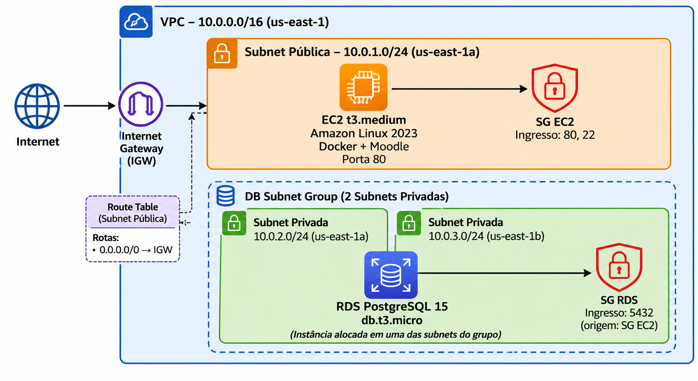

# Design de Arquitetura — Moodle Docker AWS Challenge

---

## Visão Geral

Esta solução implanta o Moodle 4.1 em uma instância EC2 (`t3.medium`) executando Amazon Linux 2023 com Docker, conectada a um banco de dados gerenciado RDS PostgreSQL 15 (`db.t3.micro`) em subnet privada. Toda a infraestrutura é provisionada via Terraform na região `us-east-1` do AWS Academy Learner Lab, respeitando as restrições de permissão do ambiente educacional: sem criação de IAM roles ou usuários, sem Route 53, ACM ou CloudFront.

O Moodle é executado como contêiner Docker construído a partir do Dockerfile do professor (`php:8.1-apache`), com todas as extensões PHP obrigatórias para o Moodle 4.x. A inicialização é totalmente automatizada via `user_data.sh`: no primeiro boot da EC2, o script instala o Docker, clona o repositório, constrói a imagem e sobe o contêiner. O `docker-entrypoint.sh` detecta a ausência de `config.php` e executa o instalador CLI do Moodle de forma não-interativa, sem nenhuma intervenção manual.

O acesso ao Moodle se dá pela porta 80 do DNS público automático da EC2 (`ec2-X-X-X-X.compute-1.amazonaws.com`). Não há HTTPS — o AWS Learn Lab bloqueia ACM e CloudFront, e o acesso HTTP direto é o mecanismo aceito neste ambiente. O banco de dados RDS nunca é exposto diretamente à internet: o Security Group do RDS aceita conexões na porta 5432 exclusivamente a partir do Security Group da EC2.

A infraestrutura é organizada em três módulos Terraform (`networking`, `compute`, `database`), orquestrados pelo `main.tf` raiz. Variáveis sensíveis (senhas, chave pública SSH) são marcadas com `sensitive = true` e fornecidas via `terraform.tfvars` ou variáveis de ambiente `TF_VAR_*`, nunca hardcoded no código.

---

## Diagrama de Arquitetura



```
Internet
    │
    ▼ HTTP :80
Internet Gateway (IGW)
    │
    ▼
Route Table Pública (0.0.0.0/0 → IGW)
    │
    ▼
┌─────────────────────────────────────────────────────────┐
│  VPC — 10.0.0.0/16  (us-east-1)                         │
│                                                         │
│  ┌──────────────────────────────────────────────────┐   │
│  │  Subnet Pública — 10.0.1.0/24 (us-east-1a)       │   │
│  │                                                  │   │
│  │  ┌────────────────────────────────────────────┐  │   │
│  │  │  Security Group EC2                        │  │   │
│  │  │  Ingresso: TCP 80 (0.0.0.0/0)              │  │   │
│  │  │  Ingresso: TCP 22 (ssh_allowed_cidr)       │  │   │
│  │  │  Egresso:  tudo liberado                   │  │   │
│  │  │                                            │  │   │
│  │  │  EC2 t3.medium — Amazon Linux 2023         │  │   │
│  │  │  Docker + Moodle 4.1 (php:8.1-apache)      │  │   │
│  │  │  IAM: LabRole (data source)                │  │   │
│  │  └────────────────────────────────────────────┘  │   │
│  └──────────────────────────────────────────────────┘   │
│  ╔════════════════════════════════════════════════════╗ │
│  ║ DB Subnet Group (us-east-1a + us-east-1b)          ║ │
│  ║                                                    ║ │
│  ║  ┌──────────────────────────────────────────────┐  ║ │
│  ║  │  Subnet Privada A — 10.0.2.0/24 (us-east-1a) │  ║ │
│  ║  └──────────────────────────────────────────────┘  ║ │
│  ║                                                    ║ │
│  ║  ┌──────────────────────────────────────────────┐  ║ │
│  ║  │  Subnet Privada B — 10.0.3.0/24 (us-east-1b) │  ║ │
│  ║  └──────────────────────────────────────────────┘  ║ │
│  ╚════════════════════════════════════════════════════╝ │
│            │                                            │
│            │ (associado ao DB Subnet Group)             │
│            ▼                                            │
│  ┌────────────────────────────────────────────────────┐ │
│  │  Security Group RDS                                │ │
│  │  Ingresso: TCP 5432 (origem: SG EC2)               │ │
│  │  Egresso:  tudo liberado                           │ │
│  │                                                    │ │
│  │  RDS PostgreSQL 15 — db.t3.micro                   │ │
│  │  20 GB gp2, publicly_accessible=false              │ │
│  │                                                    │ │
│  │  (instância alocada pela AWS em uma das subnets    │ │
│  │   do DB Subnet Group)                              │ │
│  └────────────────────────────────────────────────────┘ │
└─────────────────────────────────────────────────────────┘


Fluxo:
  Navegador → IGW → Route Table → EC2 (porta 80)
  EC2 → RDS (porta 5432, rede privada da VPC)
```

> O diagrama de referência está disponível em docs/img/diagrama.png. O diagrama textual acima representa a arquitetura implementada.

---

## Decisões de Design

| Componente | Escolha | Justificativa |
|---|---|---|
| Tipo de instância EC2 | `t3.medium` | 2 vCPUs e 4 GB RAM são suficientes para o Moodle 4.1 em carga educacional. O tipo `t3` está disponível no AWS Learn Lab e oferece boa relação custo-desempenho com créditos de CPU burstable. |
| Engine do banco de dados | RDS PostgreSQL 15 | Compatibilidade direta com o ambiente Docker local (`postgres:15`), suporte nativo no Moodle 4.1 e disponível no AWS Learn Lab. Elimina diferença de comportamento entre local e nuvem. |
| Classe da instância RDS | `db.t3.micro` | Custo mínimo para o ambiente educacional. Suficiente para carga de estudo com poucos usuários simultâneos. Os custos podem ser cobertos pelos créditos do AWS Academy Learner Lab. |
| AMI da EC2 | Amazon Linux 2023 | AMI atual mantida pela AWS, com suporte a Docker via `dnf` sem repositórios adicionais. Alinhada com as práticas recomendadas para instâncias EC2 na AWS e suportada pelo `user_data.sh`. |
| Topologia de rede | 1 subnet pública + 2 privadas | EC2 na subnet pública para acesso HTTP (porta 80) e SSH. RDS nas subnets privadas para isolamento de segurança — sem acesso direto da internet. Duas AZs distintas (`us-east-1a` e `us-east-1b`) são obrigatórias pelo `aws_db_subnet_group`. |
| Acesso IAM na EC2 | LabRole via data source | O AWS Learn Lab proíbe a criação de IAM roles, policies e instance profiles. O perfil `LabRole` pré-existente é referenciado exclusivamente via `data "aws_iam_instance_profile"`, sem nenhum bloco `resource` de IAM. |
| Instalação do Moodle | CLI não-interativa via entrypoint | A imagem `php:8.1-apache` não instala o Moodle automaticamente. O `docker-entrypoint.sh` detecta a ausência de `config.php` e executa `admin/cli/install.php --non-interactive` no primeiro boot, sem abrir o instalador web. |
| HTTPS | Não implementado | ACM e CloudFront são bloqueados no AWS Learn Lab. O acesso HTTP na porta 80 pelo DNS público da EC2 é o mecanismo aceito neste ambiente educacional. |

---

## Componentes

### VPC

- **Recurso Terraform:** `aws_vpc.main`
- **CIDR:** `10.0.0.0/16`
- **Região:** `us-east-1`
- **DNS:** `enable_dns_hostnames = true`, `enable_dns_support = true`
- **Papel:** rede privada isolada que contém todos os recursos provisionados. O DNS habilitado permite que a EC2 resolva o endpoint do RDS por nome.

### Subnets

| Nome | Tipo | CIDR | AZ | Recurso hospedado |
|---|---|---|---|---|
| `moodle-challenge-subnet-public` | Pública | `10.0.1.0/24` | `us-east-1a` | Instância EC2 |
| moodle-challenge-subnet-private-a | Privada | 10.0.2.0/24 | us-east-1a | Subnet group do RDS (instância alocada pela AWS na criação) |
| moodle-challenge-subnet-private-b | Privada | 10.0.3.0/24 | us-east-1b | Subnet group do RDS (segunda AZ obrigatória) |

A subnet pública tem `map_public_ip_on_launch = true`, garantindo IP público automático à EC2. As subnets privadas não têm rota para o IGW — o RDS é acessível apenas de dentro da VPC.

### Internet Gateway e Route Table

- **Internet Gateway:** `aws_internet_gateway.main`, associado à VPC.
- **Route Table pública:** `aws_route_table.public`, com rota `0.0.0.0/0 → aws_internet_gateway.main.id`.
- **Associação:** `aws_route_table_association.public` vincula a route table à subnet pública.
- Todo tráfego de saída da subnet pública é roteado pelo IGW. As subnets privadas não possuem route table própria com rota para a internet.

### Security Group — EC2

- **Nome:** `moodle-challenge-sg-ec2`
- **Ingresso TCP 80** — origem `0.0.0.0/0`: permite acesso HTTP público ao Moodle.
- **Ingresso TCP 22** — origem `var.ssh_allowed_cidr`: SSH restrito ao CIDR configurado. O default é `0.0.0.0/0`; recomenda-se substituir pelo IP do administrador (`x.x.x.x/32`) antes do apply.
- **Egresso** — irrestrito (`0.0.0.0/0`): necessário para que a EC2 acesse o RDS, repositórios de pacotes e o Docker Hub durante o build.

### Security Group — RDS

- **Nome:** `moodle-challenge-sg-rds`
- **Ingresso TCP 5432** — origem: `security_groups = [aws_security_group.ec2.id]`. Aceita conexões PostgreSQL exclusivamente do Security Group da EC2, nunca de CIDRs externos.
- **Egresso** — irrestrito.
- Esta regra implementa o princípio do menor privilégio: nenhuma outra origem pode alcançar o RDS na porta 5432.

### Instância EC2

- **Recurso Terraform:** `aws_instance.moodle`
- **Tipo:** `t3.medium` (2 vCPUs, 4 GB RAM)
- **AMI:** buscada via `data "aws_ami"` com filtro `al2023-ami-*`, arquitetura `x86_64`, owner `amazon`, `most_recent = true`
- **Subnet:** pública (`us-east-1a`), com IP público automático
- **Key pair:** `moodle-challenge-key`, criado a partir da variável `ec2_public_key`
- **IAM Instance Profile:** `LabRole`, referenciado via `data "aws_iam_instance_profile"`
- **User data:** `user_data.sh` executado no primeiro boot — instala Docker 24+, Docker Compose v2, clona o repositório, constrói a imagem Moodle e inicia o contêiner. O `docker-entrypoint.sh` realiza a instalação CLI do Moodle automaticamente.

### RDS PostgreSQL

- **Recurso Terraform:** `aws_db_instance.moodle`
- **Identifier:** `moodle-challenge-db`
- **Engine:** `postgres`, versão `15`
- **Classe:** `db.t3.micro`
- **Armazenamento:** 20 GB, tipo `gp2`
- **`publicly_accessible`:** `false` — sem acesso direto à internet
- **`skip_final_snapshot`:** `true` — adequado para ambiente educacional
- **`deletion_protection`:** `false`
- **Subnet group:** moodle-challenge-db-subnet-group, cobrindo as duas subnets privadas em AZs distintas (us-east-1a e us-east-1b). A AWS determina em qual subnet a instância é alocada; ambas são elegíveis.
- **Security Group:** `moodle-challenge-sg-rds`

---

## Segurança

**Isolamento de rede:** o RDS reside exclusivamente em subnets privadas sem rota para o IGW. O atributo `publicly_accessible = false` impede a atribuição de endpoint público. Nenhuma regra de Security Group permite acesso ao RDS de fora da VPC.

**Princípio do menor privilégio nos Security Groups:** o SG do RDS aceita a porta 5432 somente via referência ao ID do SG da EC2 (`security_groups`), nunca via `cidr_blocks`. Isso garante que apenas o contêiner Moodle na EC2 possa conectar ao banco.

**Gerenciamento de credenciais:** as variáveis `db_username`, `db_password`, `ec2_public_key` e `moodle_admin_password` são declaradas com `sensitive = true` em todos os módulos. Os valores são fornecidos via `terraform.tfvars` (coberto pelo `.gitignore` com o padrão `*.tfvars`) ou via variáveis de ambiente `TF_VAR_*` nos workflows de CI/CD. Nenhuma credencial aparece hardcoded nos arquivos `.tf`.

**Acesso SSH:** a variável `ssh_allowed_cidr` tem default `0.0.0.0/0` acompanhado de aviso explícito na `description`. Para ambientes reais, deve ser substituída pelo IP do administrador no formato `x.x.x.x/32`.

**IAM sem criação de recursos:** o perfil `LabRole` é referenciado exclusivamente via `data "aws_iam_instance_profile"`. Nenhum bloco `resource "aws_iam_role"`, `resource "aws_iam_user"` ou `resource "aws_iam_instance_profile"` foi declarado — respeitando as restrições do AWS Learn Lab.

**Arquivos sensíveis no `.gitignore`:** os padrões `.env`, `.env.*`, `*.tfvars`, `terraform.tfstate`, `terraform.tfstate.backup`, `*.pem`, `*.key` e `id_rsa` estão cobertos, impedindo commit acidental de credenciais.

---

## Escalabilidade

**Limitações atuais do ambiente:** a arquitetura usa uma única instância EC2 sem balanceamento de carga ou auto scaling. O RDS `db.t3.micro` não tem Multi-AZ habilitado (`multi_az = false` por padrão) e opera em single-AZ. Essas escolhas são adequadas para o escopo educacional do AWS Learn Lab, mas não são adequadas para produção com carga real.

**Caminho de escala em produção:**

| Componente atual | Alternativa de produção | Mudança no Terraform |
|---|---|---|
| EC2 single instance | Auto Scaling Group + Launch Template | Substituir `aws_instance` por `aws_autoscaling_group` + `aws_launch_template` |
| Sem Load Balancer | Application Load Balancer (ALB) | Adicionar `aws_lb`, `aws_lb_listener`, `aws_lb_target_group` |
| RDS single-AZ | RDS Multi-AZ | Adicionar `multi_az = true` no `aws_db_instance` |
| `db.t3.micro` | `db.t3.small` ou superior | Alterar `db_instance_class` em `modules/database/variables.tf` |
| HTTP porta 80 | HTTPS com ACM + ALB | Adicionar `aws_acm_certificate` e listener HTTPS no ALB (requer domínio Route 53) |
| Estado local | Backend S3 + DynamoDB | Preencher `backend.tf.example` e renomear para `backend.tf` |

As mudanças acima não são viáveis no AWS Learn Lab (IAM, Route 53 e ACM são restritos), mas representam o caminho natural de evolução da arquitetura para um ambiente de produção real.

---

## Custo Estimado

Estimativa para a região `us-east-1`, uso contínuo On-Demand, 730 horas/mês.

| Serviço | Tipo/Configuração | Custo estimado (USD/mês) |
|---|---|---|
| EC2 | `t3.medium`, On-Demand, 730h | ~$30,37 |
| RDS PostgreSQL | `db.t3.micro`, 20 GB gp2, 730h | ~$25,92 |
| Armazenamento EBS (EC2) | 8 GB gp3 (padrão AMI) | ~$0,64 |
| Transferência de dados | ~1 GB saída/mês | ~$0,09 |
| **Total estimado** | | **~$57,02** |

> Os valores acima são aproximações baseadas nos preços públicos On-Demand da AWS para us-east-1. Os créditos do AWS Academy Learner Lab podem cobrir parte ou totalidade desse custo, dependendo do saldo disponível e das condições do laboratório — a cobertura integral não é garantida.
>
> Referência: [AWS Pricing Calculator](https://calculator.aws/) — acesse para gerar uma estimativa atualizada e obter um link compartilhável com os valores exatos para a sua configuração.

---

## Referências

- [Moodle 4.x System Requirements](https://moodledev.io/docs/gettingstarted/requirements)
- [Terraform AWS Provider ~> 5.0](https://registry.terraform.io/providers/hashicorp/aws/latest)
- [AWS Pricing Calculator](https://calculator.aws/)
- [AWS Learn Lab — Restrições de permissão](aws-learn-lab-setup.md)
- [Rubrica de Avaliação](evaluation-rubric.md)
- [Template de Arquitetura](architecture-design-template.md)